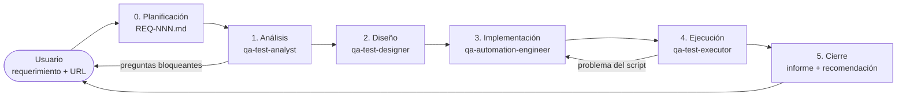

# AutomatizadorIA — Agente QA basado en ISTQB

Mini proyecto agéntico construido sobre **Claude Code** que actúa como un equipo de pruebas
completo: a partir de un requerimiento escrito en lenguaje natural, analiza, diseña casos de prueba
con técnicas ISTQB, genera el feature en **Gherkin (español)**, lo automatiza con
**Java + Cucumber + Selenium**, lo ejecuta, captura evidencias y emite el informe de cierre.

```
Requerimiento (chat)  ──►  /qa-flow  ──►  feature Gherkin + código + ejecución + evidencias + informe
```

---

## Tabla de contenido
- [Cómo funciona](#cómo-funciona)
- [Componentes agénticos](#componentes-agénticos)
- [Framework de automatización](#framework-de-automatización)
- [Estructura del repositorio](#estructura-del-repositorio)
- [Requisitos e instalación](#requisitos-e-instalación)
- [Uso](#uso)
- [Reportes y evidencias](#reportes-y-evidencias)
- [Trazabilidad y convenciones](#trazabilidad-y-convenciones)
- [Casos implementados](#casos-implementados)
- [Próximos pasos](#próximos-pasos)

---

## Cómo funciona

El agente sigue el **proceso de prueba ISTQB CTFL v4.0**. Un orquestador (la skill `/qa-flow`) asume
el rol de *Test Manager* y delega cada fase en un subagente especializado, con puntos de control
entre fases.



| Fase ISTQB | Responsable | Entregable |
|---|---|---|
| 0. Planificación | `/qa-flow` (orquestador) | `requirements/REQ-NNN.md` |
| 1. Análisis | `qa-test-analyst` | `qa-artifacts/REQ-NNN/01-analisis.md` — revisión estática, condiciones de prueba, riesgos, supuestos |
| 2. Diseño | `qa-test-designer` | `02-diseno.md` (técnicas, casos, matriz de trazabilidad) + `REQ-NNN_<nombre>.feature` |
| 3. Implementación | `qa-automation-engineer` | Page Objects + Steps Java, explorando la app con Playwright MCP |
| 4. Ejecución | `qa-test-executor` | `03-ejecucion.md`, clasificación de fallos, `defectos/DEF-NNN.md` |
| 5. Cierre | `/qa-flow` | `04-informe-cierre.md` — métricas, criterios de salida, recomendación (Apto / No apto) |

**Puntos de control del Test Manager**
- Preguntas *bloqueantes* del análisis → se consultan al usuario antes de diseñar.
- Cobertura de condiciones de prioridad alta < 100 % → el diseño se devuelve.
- Fallos clasificados como *problema del script* → vuelven a implementación (máx. 2 iteraciones).
- Un *defecto del producto* **nunca** se "arregla" modificando el test: se reporta.

---

## Componentes agénticos

Todo vive en [`.claude/`](.claude/) y Claude Code lo carga automáticamente al abrir el proyecto.

### Subagentes — [`.claude/agents/`](.claude/agents/)
| Agente | Rol ISTQB | Herramientas clave |
|---|---|---|
| `qa-test-analyst` | Test Analyst (CTFL / CTAL-TA) | Lectura, Playwright MCP (vistazo al SUT) |
| `qa-test-designer` | Test Designer / BDD | Lectura y escritura de features (sin código) |
| `qa-automation-engineer` | Test Automation Engineer (CTAL-TAE) | Gradle, Playwright MCP para descubrir locators |
| `qa-test-executor` | Test Executor / gestión de defectos | Gradle, lectura de `cucumber.json`, Playwright MCP para reproducir defectos |

### Skills propias — [`.claude/skills/`](.claude/skills/)
| Skill | Contenido |
|---|---|
| `qa-flow` | Orquestador del proceso completo (invocable con `/qa-flow`) |
| `istqb-test-design` | 7 principios, revisión estática, riesgo, EP, BVA, tablas de decisión, transición de estados, predicción de errores |
| `gherkin-writing` | Reglas de Gherkin declarativo en español y etiquetas de trazabilidad |
| `selenium-cucumber-java` | Convenciones del framework, locators, comandos, reportes y evidencias |
| `defect-reporting` | Clasificación de fallos, severidad/prioridad y ciclo de vida del defecto |

### Skills de la comunidad (instaladas con [`skills`](https://skills.sh) de Vercel Labs)
`qa-manual-istqb`, `cucumber-best-practices`, `selenium-cucumber-expert`, `webapp-selenium-testing`
— registradas en [`skills-lock.json`](skills-lock.json). Son referencia complementaria: **ante
conflicto mandan las skills propias y `CLAUDE.md`** (Gradle en lugar de Maven, Gherkin en español,
sin ExtentReports). Para restaurarlas: `npx skills experimental_install`.

### Hook de trazabilidad — [`.claude/hooks/validate_feature.py`](.claude/hooks/validate_feature.py)
Se ejecuta tras cada escritura de un `.feature` y bloquea (el agente debe corregir) si:
- falta `# language: es`;
- la Característica no tiene `@REQ-NNN`;
- un escenario no tiene `@TC-NNN` o `@prioridad-alta|media|baja`;
- un `@TC-NNN` ya existe en otro feature.

### MCP
- **Playwright MCP** (plugin oficial): exploración del SUT, descubrimiento de locators y textos reales,
  reproducción manual de defectos.

---

## Framework de automatización

| Pieza | Tecnología |
|---|---|
| Lenguaje | Java 21 |
| BDD | Cucumber 7 (Gherkin `# language: es`) |
| Navegador | Selenium 4 (Selenium Manager descarga los drivers) |
| Runner | JUnit 5 Platform Suite |
| DI por escenario | PicoContainer (`TestContext`) |
| Aserciones | AssertJ |
| Build | Gradle 9 (wrapper incluido) |
| Reporte enriquecido | masterthought cucumber-reporting |

Patrones: **Page Object Model**, esperas explícitas (sin `Thread.sleep`), aserciones solo en pasos
`Entonces`, configuración sobreescribible con `-Dclave=valor`, soporte multi-aplicación
(`baseUrl`, `<app>.baseUrl`).

---

## Estructura del repositorio

```
.
├── CLAUDE.md                          # Reglas del proyecto para Claude
├── .claude/
│   ├── agents/                        # 4 subagentes QA
│   ├── skills/                        # skills propias + comunidad
│   ├── hooks/validate_feature.py      # hook de trazabilidad
│   └── settings.json                  # permisos y hooks
├── docs/templates/                    # plantillas ISTQB de cada artefacto
├── requirements/                      # REQ-NNN.md (requerimiento literal + aclaraciones)
├── qa-artifacts/REQ-NNN/              # 01-analisis, 02-diseno, 03-ejecucion, 04-informe-cierre, defectos/
├── src/test/java/com/qa/automation/
│   ├── runners/CucumberTestSuite.java
│   ├── hooks/Hooks.java               # evidencias por paso, log de entorno, cierre del driver
│   ├── support/                       # ConfigReader, DriverFactory, TestContext, StepTracker
│   ├── pages/                         # BasePage + Page Objects (orangehrm/, ...)
│   └── steps/                         # step definitions en español
├── src/test/resources/
│   ├── features/                      # REQ-NNN_<nombre>.feature
│   ├── config/config.properties
│   └── junit-platform.properties      # excluye @manual y @wip por defecto
└── build.gradle.kts                   # dependencias + tarea cucumberReport
```

---

## Requisitos e instalación

- **Java 21** (JDK)
- **Google Chrome** (o Edge / Firefox)
- **Claude Code** con el plugin **Playwright** habilitado (para la parte agéntica)
- Node.js (solo si quieres restaurar/actualizar las skills de la comunidad)

```bash
git clone https://github.com/harcalow/AutomatizadorIA.git
cd AutomatizadorIA
./gradlew compileTestJava        # Windows: .\gradlew.bat compileTestJava
```

Plugins recomendados para Claude Code (`/plugin`): `jdtls-lsp` (diagnóstico Java), `context7`
(documentación actualizada), `claude-code-setup` (recomendaciones de automatización).

---

## Uso

### 1. Con el agente (flujo completo)
Abre el proyecto en Claude Code y escribe:

```
/qa-flow Probar el login de https://opensource-demo.orangehrmlive.com/web/index.php/auth/login
         Username: Admin  Password: admin123. Evaluar escenario exitoso y negativos.
```

El agente registra `REQ-NNN`, te pregunta lo que sea bloqueante y entrega feature, código,
ejecución, evidencias e informe de cierre.

### 2. Ejecutar las pruebas manualmente
```bash
./gradlew test                                               # todo (excluye @manual y @wip)
./gradlew test -Dcucumber.filter.tags="@REQ-002"             # un requerimiento
./gradlew test -Dcucumber.filter.tags="@smoke"               # suite smoke
./gradlew test -Dheadless=false -Dbrowser=edge               # navegador visible / otro
./gradlew test -Devidence=failed                             # capturas solo en fallos
```
En PowerShell usa `.\gradlew.bat` y comillas alrededor del argumento completo:
`.\gradlew.bat test "-Dcucumber.filter.tags=@REQ-002"`.

| Propiedad | Defecto | Descripción |
|---|---|---|
| `browser` | `chrome` | `chrome`, `edge`, `firefox` |
| `headless` | `true` | Ventana fija 1920×1080 en headless |
| `evidence` | `all` | `all` (captura por paso), `failed`, `none` |
| `timeout` | `10` | Espera explícita general (s) |
| `baseUrl` / `orangehrm.baseUrl` | ver `config.properties` | URL de cada aplicación |

---

## Reportes y evidencias

Cada ejecución genera:

| Reporte | Ruta |
|---|---|
| **Enriquecido** (gráficos, tags, capturas por paso) | `build/reports/cucumber-html/cucumber-html-reports/overview-features.html` |
| Nativo de Cucumber | `build/reports/cucumber/cucumber.html` |
| JSON (análisis automático) | `build/reports/cucumber/cucumber.json` |
| **Histórico por requerimiento** | `qa-artifacts/REQ-NNN/reportes/<fecha-hora>/` |

Evidencias:
- Captura **después de cada paso**, nombrada `Paso N - <texto del paso>` (y `[FALLO]` si falla).
- Captura **intermedia** en pasos de acción (p. ej. formulario diligenciado antes de enviar), vía
  `context.evidence("...")`.
- Espera a que la página esté estable antes de capturar (evita capturas en blanco en SPAs).
- Log por escenario: inicio, navegador, etiquetas y URL final.

> Los históricos en `qa-artifacts/*/reportes/` no se versionan (≈12 MB por ejecución); se
> regeneran ejecutando las pruebas.

---

## Trazabilidad y convenciones

```
REQ-NNN (requirements/) → CA-NN (criterio) → CP-NN (condición) → TC-NNN (@TC en el feature) → DEF-NNN
```

- IDs **globales y secuenciales**; nunca se reutilizan.
- Etiquetas obligatorias: `@REQ-NNN`, `@TC-NNN`, `@prioridad-*`, `@tecnica-*`, `@smoke`/`@regresion`,
  `@negativo`, `@manual`, `@wip`.
- Gherkin declarativo, un comportamiento por escenario, escenarios independientes.
- Criterios de salida por defecto: 100 % de condiciones de prioridad alta ejecutadas, 0 defectos
  críticos/altos abiertos, trazabilidad completa.

---

## Casos implementados

| Requerimiento | SUT | Casos | Resultado |
|---|---|---|---|
| **REQ-001** — Inicio de sesión (ejemplo de referencia) | [saucedemo.com](https://www.saucedemo.com) | TC-001, TC-002 (5 ejecuciones) | ✅ 5/5 |
| **REQ-002** — Inicio de sesión OrangeHRM | [OrangeHRM demo](https://opensource-demo.orangehrmlive.com) | TC-003 … TC-012 (12 ejecuciones automatizadas, 2 manuales) | ✅ 12/12 — *Apto con observaciones* |

REQ-002 cubre 14 condiciones de prueba con partición de equivalencia, tabla de decisión,
transición de estados y predicción de errores: login exitoso, usuario en minúsculas, contraseña
incorrecta / en mayúsculas / con espacios, usuario inexistente, campos obligatorios vacíos, usuario
solo con espacios, reintento tras fallo y acceso directo al Dashboard sin sesión. Ver
[`qa-artifacts/REQ-002/`](qa-artifacts/REQ-002/).

---

## Próximos pasos
- Ejecutar los casos manuales pendientes (TC-011, TC-012).
- Revisar la espera del Dashboard en TC-009 (riesgo de flaky por latencia de la demo).
- Integrar Jira/Azure DevOps (MCP) para leer requerimientos y publicar defectos.
- Pipeline CI (GitHub Actions) con publicación del reporte enriquecido.
- Actualizar Selenium para soporte CDP de Chrome reciente.
