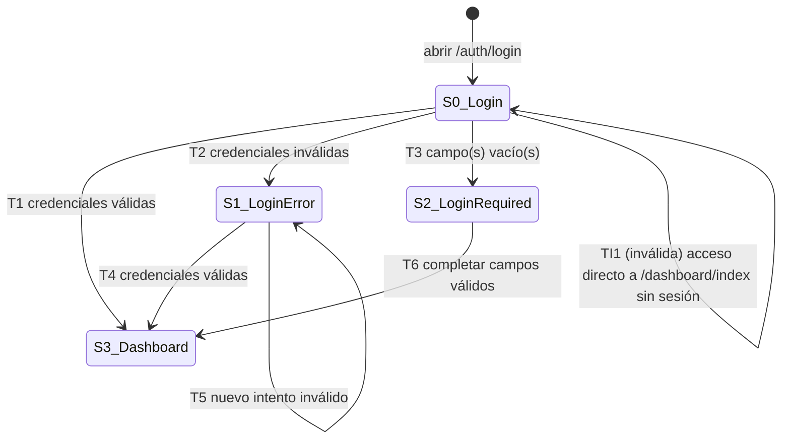

# Diseño de prueba — REQ-002

Base: `requirements/REQ-002.md` (CA-01, CA-02) y `qa-artifacts/REQ-002/01-analisis.md` (CP-01..CP-14, supuestos RE-01..RE-11).
Feature: `src/test/resources/features/REQ-002_inicio_sesion_orangehrm.feature`.
Numeración de casos: continúa desde TC-002 (último ID en `REQ-001_inicio_sesion.feature`) → TC-003..TC-012.

Oráculos (supuestos del análisis):
- Ingreso correcto: URL `/web/index.php/dashboard/index` y encabezado "Dashboard" visible (RE-01).
- Credenciales inválidas: alerta "Invalid credentials" y permanencia en `/auth/login` (RE-02, RE-04).
- Campo obligatorio vacío: texto "Required" bajo el campo vacío, sin envío ni cambio de URL (RE-03, RE-08).

## 1. Aplicación de técnicas

### CP-01, CP-02, CP-05, CP-06, CP-07 — Combinaciones de usuario/contraseña (tabla de decisión)
Condiciones: C1 = Username informado · C2 = Password informado · C3 = Credenciales coinciden con una cuenta.
Acciones: A1 = Ingreso al Dashboard · A2 = "Invalid credentials" · A3 = "Required" en el/los campo(s) vacío(s).

| Regla | R1 | R2 | R3 | R4 | R5 |
|---|---|---|---|---|---|
| C1 Username informado | S | S | N | S | N |
| C2 Password informado | S | S | S | N | N |
| C3 Credenciales coinciden | S | N | – | – | – |
| A1 Ingreso al Dashboard | X | | | | |
| A2 "Invalid credentials" | | X | | | |
| A3 "Required" | | | Username | Password | Username y Password |
| Condición | CP-01 | CP-02 | CP-05 | CP-06 | CP-07 |
| Caso | TC-003 | TC-005 (fila 1) | TC-007 (fila 1) | TC-007 (fila 2) | TC-007 (fila 3) |

Columnas colapsadas: con C1=N o C2=N la validación de cliente impide el envío, por lo que C3 es irrelevante (–).

Cobertura: 5/5 columnas factibles = 100 %

### CP-01, CP-03, CP-04, CP-08, CP-09, CP-12, CP-13 — Particiones de Username y Password (EP)
Cada partición se ejercita una vez combinada con un valor válido (o neutro) en el otro campo, para aislar el efecto.

| ID | Campo | Partición | Clase | Valor representativo | Resultado esperado | Caso |
|---|---|---|---|---|---|---|
| U1 | Username | Usuario existente exacto | Válida | `Admin` | Dashboard | TC-003 |
| U2 | Username | Variante de mayúsculas del existente | Válida (supuesto RE-05) | `admin` | Dashboard | TC-004 |
| U3 | Username | Usuario inexistente | Inválida | `usuario_inexistente_qa` | "Invalid credentials" | TC-005 (fila 2) |
| U4 | Username | Vacío | Inválida | `""` | "Required" (Username) | TC-007 (filas 1 y 3) |
| U5 | Username | Solo espacios | Inválida (supuesto RE-08) | `"   "` | "Required" (Username) | TC-008 |
| U6 | Username | Existente con espacios alrededor | Inválida (supuesto RE-07) | `" Admin "` | "Invalid credentials" | TC-011 (manual) |
| P1 | Password | Correcta | Válida | `admin123` | Dashboard | TC-003 |
| P2 | Password | Incorrecta | Inválida | `wrongPass123` | "Invalid credentials" | TC-005 (fila 1) |
| P3 | Password | Variante de mayúsculas de la correcta | Inválida (RE-06) | `ADMIN123` | "Invalid credentials" | TC-005 (fila 3) |
| P4 | Password | Vacía | Inválida | `""` | "Required" (Password) | TC-007 (filas 2 y 3) |
| P5 | Password | Correcta con espacios alrededor | Inválida (RE-07) | `" admin123 "` | "Invalid credentials" | TC-006 |

Cobertura: Username 6/6 = 100 % (5/6 automatizadas; U6 manual) · Password 5/5 = 100 % (todas automatizadas) · Total 11/11 = 100 %.

Nota técnica: Gherkin recorta los espacios de las celdas de `Ejemplos`, por lo que las particiones con espacios significativos (P5, U5, U6) se escriben como `Escenario` con el valor literal entre comillas en el paso, no como filas de un esquema.

### CP-02, CP-03, CP-04 — Mensaje genérico ante credenciales inválidas (EP + predicción de errores)
Las tres clases inválidas con ambos campos informados (P2, U3, P3) deben producir la **misma** salida ("Invalid credentials"), lo que verifica la no enumeración de usuarios (RE-04). Se agrupan en el esquema TC-005 con columna `condicion`.

Cobertura: 3/3 clases = 100 %

### CP-04, CP-08, CP-09, CP-12, CP-13 — Predicción de errores
| Error previsto | Dato | Condición | Caso |
|---|---|---|---|
| La contraseña no distingue mayúsculas | `Admin` / `ADMIN123` | CP-04 | TC-005 (fila 3) |
| La contraseña se recorta (trim) | `Admin` / `" admin123 "` | CP-08 | TC-006 |
| El usuario distingue mayúsculas (rechaza `admin`) | `admin` / `admin123` | CP-09 | TC-004 |
| El usuario con espacios se acepta o produce error no controlado | `" Admin "` / `admin123` | CP-12 | TC-011 (manual) |
| Campo con solo espacios se envía como valor válido | `"   "` / `admin123` | CP-13 | TC-008 |

Cobertura: 5/5 errores previstos = 100 % (4 automatizados, 1 manual).

### CP-01, CP-10, CP-11 — Transición de estados de la sesión

| Transición | Origen → Destino | Evento | Caso |
|---|---|---|---|
| T1 | Sin sesión (Login) → Autenticado (Dashboard) | credenciales válidas | TC-003 |
| T2 | Login → Login con error | credenciales inválidas | TC-005, TC-006 |
| T3 | Login → Login con "Required" | campo(s) vacío(s) | TC-007, TC-008 |
| T4 | Login con error → Dashboard | credenciales válidas tras fallo | TC-009 |
| T5 | Login con error → Login con error | segundo intento inválido | No cubierta (consumiría intentos adicionales contra "Admin") |
| T6 | Login con "Required" → Dashboard | completar y enviar | No cubierta (riesgo bajo, no derivada como condición); candidata a sesión exploratoria |
| TI1 (inválida) | Sin sesión → Dashboard | acceso directo por URL | TC-010 (debe redirigir a Login) |

Cobertura: transiciones válidas 4/6 = 67 % (las 3 transiciones exigidas por CP-01/CP-10 y su contexto: 3/3 = 100 %); transiciones inválidas de riesgo 1/1 = 100 %; estados 4/4 = 100 %.

### CP-14 — Enmascaramiento de la contraseña (lista de comprobación)
| Ítem | Verificación | Caso |
|---|---|---|
| LC-01 | Al escribir en Password se muestran puntos/asteriscos, no el texto | TC-012 (manual) |

Cobertura: 1/1 = 100 % (manual).

### Control de intentos fallidos contra la cuenta compartida "Admin"
| Caso | Dato | ¿Envía intento fallido contra "Admin"? |
|---|---|---|
| TC-005 fila 1 | `Admin` / `wrongPass123` | Sí (1) |
| TC-005 fila 2 | `usuario_inexistente_qa` / `admin123` | No (usuario inexistente) |
| TC-005 fila 3 | `Admin` / `ADMIN123` | Sí (1) |
| TC-006 | `Admin` / `" admin123 "` | Sí (1) |
| TC-007 fila 2 | `Admin` / vacío | No (la validación "Required" impide el envío) |
| TC-009 | `Admin` / `wrongPass456` (seguido de ingreso válido) | Sí (1) |
| TC-011 | `" Admin "` / `admin123` | Manual, fuera del conteo automatizado |

**Total automatizado por ejecución: 4 intentos fallidos contra "Admin"** (dentro del límite de ~4). Los negativos de usuario inexistente se cubren con un único representativo para no inflar la suite. Además TC-003, TC-004 y TC-009 producen ingresos válidos que, si el SUT tuviera contador de fallos que se reinicia al autenticar, lo restablecen. CP-12 se deja manual en parte por la incertidumbre de si `" Admin "` cuenta como intento sobre "Admin".

## 2. Casos de prueba
| ID | Título | Condiciones | Técnica | Prioridad | Precondiciones | Datos | Resultado esperado | Automatizable |
|---|---|---|---|---|---|---|---|---|
| TC-003 | Inicio de sesión exitoso con credenciales válidas del administrador (`@smoke`) | CP-01 | EP (U1, P1) + Tabla de decisión (R1) + Transición T1 | Alta | Navegador sin sesión en la página de login de OrangeHRM | `Admin` / `admin123` | Redirección a `/dashboard/index`, encabezado "Dashboard" visible | Sí |
| TC-004 | Inicio de sesión exitoso con el usuario escrito en minúsculas | CP-09 | Predicción de errores / EP (U2) | Media | Ídem TC-003 | `admin` / `admin123` | Dashboard visible (si el SUT lo rechaza: desviación del supuesto RE-05, confirmar con el usuario, no defecto) | Sí |
| TC-005 | Inicio de sesión rechazado por credenciales inválidas - `<condicion>` (esquema, 3 filas) | CP-02, CP-03, CP-04 | Tabla de decisión (R2) + EP (U3, P2, P3) + Predicción de errores | Alta | Ídem TC-003 | `Admin`/`wrongPass123`; `usuario_inexistente_qa`/`admin123`; `Admin`/`ADMIN123` | Alerta "Invalid credentials" (mismo mensaje en las 3 filas) y permanece en `/auth/login` | Sí |
| TC-006 | Inicio de sesión rechazado con la contraseña rodeada de espacios | CP-08 | Predicción de errores / EP (P5) | Media | Ídem TC-003 | `Admin` / `" admin123 "` | Alerta "Invalid credentials", permanece en `/auth/login` | Sí |
| TC-007 | Inicio de sesión impedido por campos obligatorios vacíos - `<condicion>` (esquema, 3 filas) | CP-05, CP-06, CP-07 | Tabla de decisión (R3, R4, R5) + EP (U4, P4) | Media | Ídem TC-003 | vacío/`admin123`; `Admin`/vacío; vacío/vacío | "Required" bajo Username / Password / ambos; no hay envío ni cambio de URL | Sí |
| TC-008 | Inicio de sesión impedido cuando el usuario contiene solo espacios | CP-13 | Predicción de errores / EP (U5) | Baja | Ídem TC-003 | `"   "` / `admin123` | "Required" bajo Username, permanece en `/auth/login` (supuesto RE-08, confirmar en primera ejecución) | Sí |
| TC-009 | Inicio de sesión exitoso después de un intento fallido | CP-10 | Transición de estados (T2 → T4) | Media | Ídem TC-003; un intento previo fallido visible ("Invalid credentials") | Fallo: `Admin`/`wrongPass456`; luego `Admin`/`admin123` | Dashboard visible tras el reintento | Sí |
| TC-010 | Acceso directo al Dashboard sin sesión redirige al inicio de sesión | CP-11 | Transición de estados (inválida TI1) | Media | Navegador sin cookies ni sesión | URL `/web/index.php/dashboard/index` | Redirección a `/auth/login`, formulario de login visible | Sí |
| TC-011 | Inicio de sesión rechazado con el usuario rodeado de espacios | CP-12 | Predicción de errores / EP (U6) | Baja | Ídem TC-003 | `" Admin "` / `admin123` | "Invalid credentials", permanece en `/auth/login` (supuesto RE-07, a confirmar) | No (`@manual`): comportamiento incierto y posible impacto en el contador de "Admin"; se valida en sesión exploratoria |
| TC-012 | La contraseña escrita se muestra enmascarada | CP-14 | Lista de comprobación | Baja | Ídem TC-003 | `admin123` (sin enviar) | El campo muestra caracteres ocultos, no el texto en claro | No (`@manual`): verificación visual de lista de comprobación |

Notas de diseño:
- Cada escenario inicia en un contexto de navegador limpio (sin cookies) y no depende de otros escenarios; no se usa `Antecedentes` porque TC-010 parte de un estado distinto (sin pasar por la página de login).
- Las credenciales `Admin` / `admin123` son públicas (impresas en la propia página de la demo) y fueron dadas por el usuario; se escriben literalmente por legibilidad. La implementación del paso puede resolverlas desde configuración (supuesto del análisis, sección 4) sin cambiar el Gherkin.
- Paradoja del pesticida: variar `wrongPass123` / `wrongPass456` / `usuario_inexistente_qa` entre ciclos de regresión.

## 3. Matriz de trazabilidad
| Requerimiento | Criterio | Condición | Caso | Escenario Gherkin |
|---|---|---|---|---|
| REQ-002 | CA-01 | CP-01 | TC-003 | features/REQ-002_inicio_sesion_orangehrm.feature:13 |
| REQ-002 | CA-01 | CP-09 | TC-004 | features/REQ-002_inicio_sesion_orangehrm.feature:19 |
| REQ-002 | CA-02 | CP-02 | TC-005 (fila 1) | features/REQ-002_inicio_sesion_orangehrm.feature:25 (ejemplo :33) |
| REQ-002 | CA-02 | CP-03 | TC-005 (fila 2) | features/REQ-002_inicio_sesion_orangehrm.feature:25 (ejemplo :34) |
| REQ-002 | CA-02 | CP-04 | TC-005 (fila 3) | features/REQ-002_inicio_sesion_orangehrm.feature:25 (ejemplo :35) |
| REQ-002 | CA-02 | CP-08 | TC-006 | features/REQ-002_inicio_sesion_orangehrm.feature:38 |
| REQ-002 | CA-02 | CP-05 | TC-007 (fila 1) | features/REQ-002_inicio_sesion_orangehrm.feature:45 (ejemplo :53) |
| REQ-002 | CA-02 | CP-06 | TC-007 (fila 2) | features/REQ-002_inicio_sesion_orangehrm.feature:45 (ejemplo :54) |
| REQ-002 | CA-02 | CP-07 | TC-007 (fila 3) | features/REQ-002_inicio_sesion_orangehrm.feature:45 (ejemplo :55) |
| REQ-002 | CA-02 | CP-13 | TC-008 | features/REQ-002_inicio_sesion_orangehrm.feature:58 |
| REQ-002 | CA-01, CA-02 | CP-10 | TC-009 | features/REQ-002_inicio_sesion_orangehrm.feature:65 |
| REQ-002 | CA-01 (implícito) | CP-11 | TC-010 | features/REQ-002_inicio_sesion_orangehrm.feature:72 |
| REQ-002 | CA-02 | CP-12 | TC-011 (manual) | features/REQ-002_inicio_sesion_orangehrm.feature:78 |
| REQ-002 | CA-01 (implícito) | CP-14 | TC-012 (manual) | features/REQ-002_inicio_sesion_orangehrm.feature:85 |

## 4. Resumen de cobertura
| Prioridad | Condiciones | Cubiertas | % |
|---|---|---|---|
| Alta | 4 (CP-01..CP-04) | 4 (todas automatizadas) | 100 % |
| Media | 7 (CP-05..CP-11) | 7 (todas automatizadas) | 100 % |
| Baja | 3 (CP-12..CP-14) | 3 (CP-13 automatizada; CP-12 y CP-14 manuales) | 100 % |
| **Total** | **14** | **14** | **100 %** |

| Técnica | Cobertura |
|---|---|
| Tabla de decisión | 5/5 columnas = 100 % |
| Partición de equivalencia | 11/11 particiones = 100 % (10/11 automatizadas) |
| Predicción de errores | 5/5 errores previstos = 100 % (4/5 automatizados) |
| Transición de estados | válidas 4/6 = 67 % (exigidas por condiciones 3/3 = 100 %); inválidas de riesgo 1/1 = 100 % |
| Lista de comprobación | 1/1 = 100 % (manual) |
| Valores límite | No aplica (sin rangos ni longitudes definidas) |

Casos: 10 (automatizables 8, manuales 2) · Ejecuciones automatizadas (contando filas de esquema): 12 · Intentos fallidos contra "Admin" por ejecución: 4.
